# AI workflow review — October 11, 2026

These 18 unretouched screenshots use synthetic records, mocked AI responses and
an in-memory computer-input adapter against the actual frontend controller.
They demonstrate UI behavior; they do not show a real endpoint session or
provider execution. The [manifest](manifest.json) records provenance and hashes.
Production captures and real-provider results remain private in ignored output.

## Script context and review

| Desktop | Phone |
| --- | --- |
| [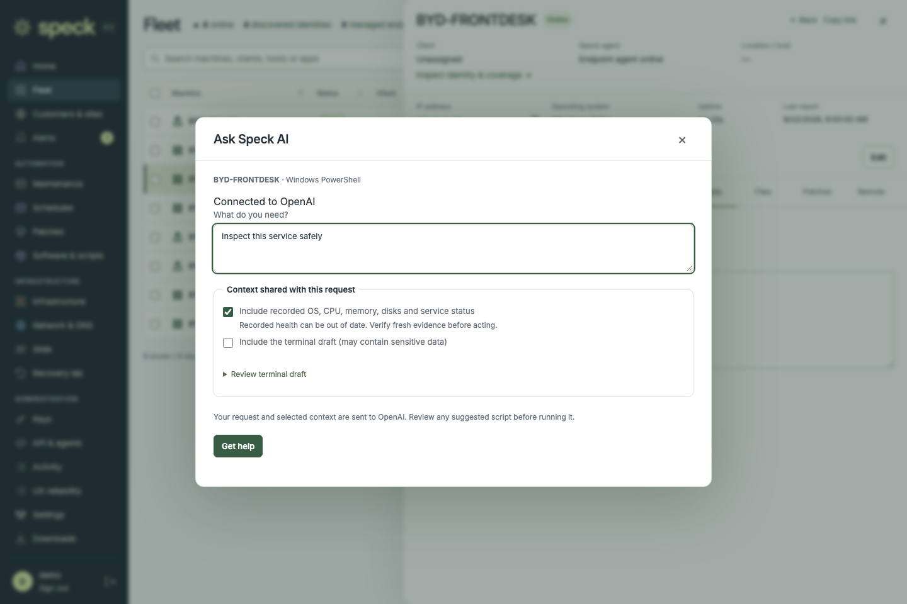](script-context-1440.png) | [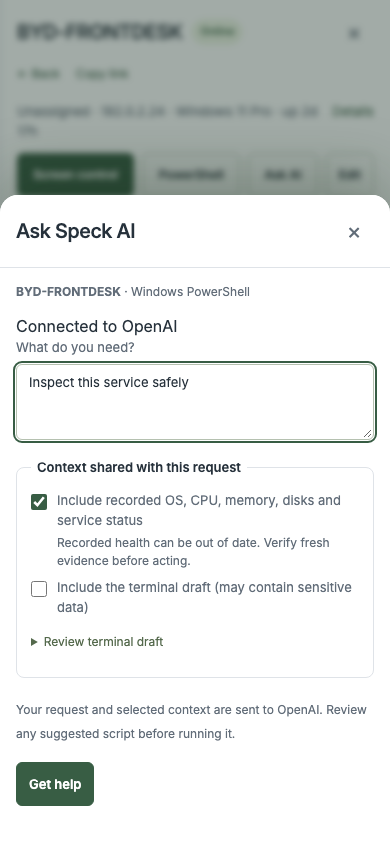](script-context-390.png) |
| [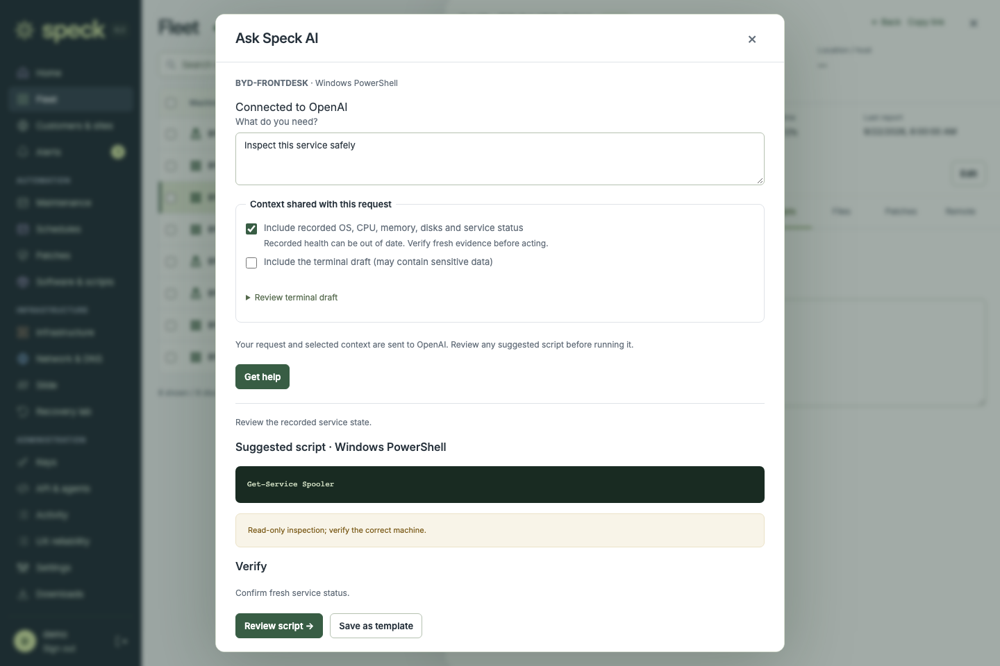](script-review-1440.png) | [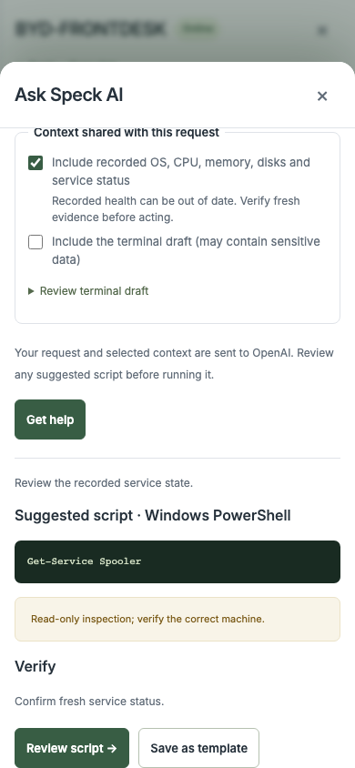](script-review-390.png) |
| [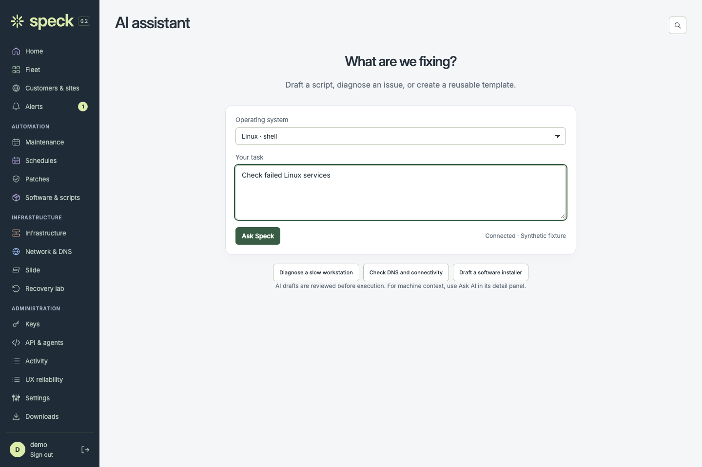](assistant-linux-desktop.png) | [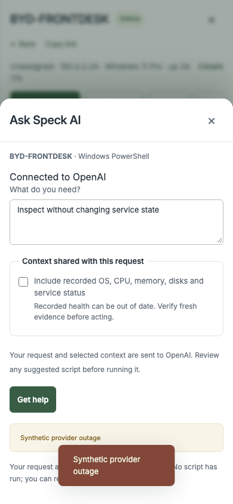](script-provider-error-phone.png) |

[Failed target handoff](script-target-unavailable-desktop.png) retains the draft.

## Reviewed computer steps

| Desktop | Phone |
| --- | --- |
| [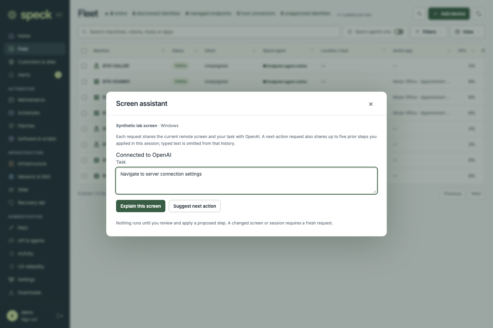](screen-task-1440.png) | [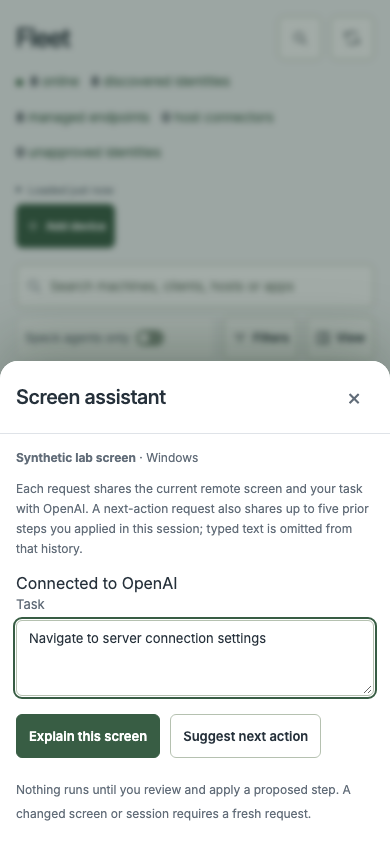](screen-task-390.png) |
| [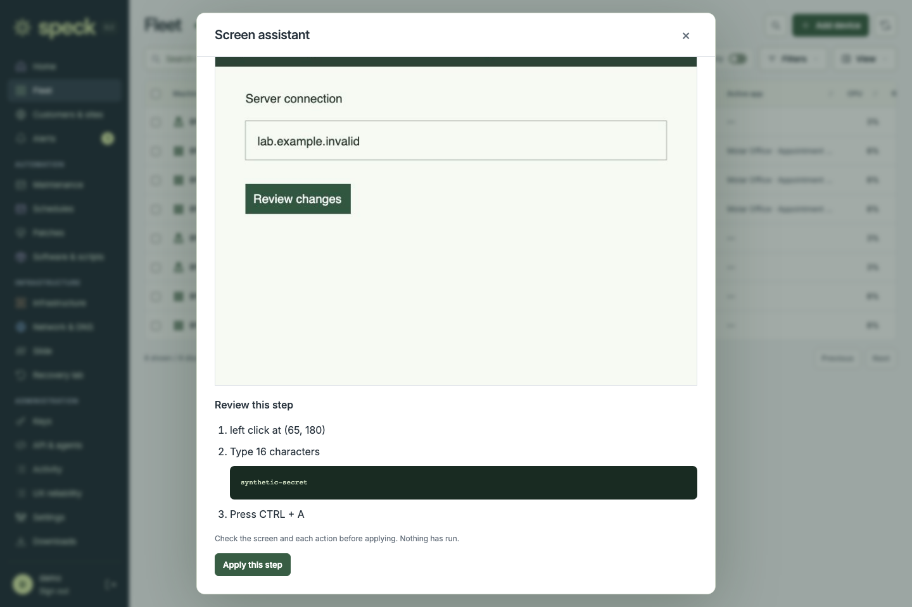](screen-step-review-1440.png) | [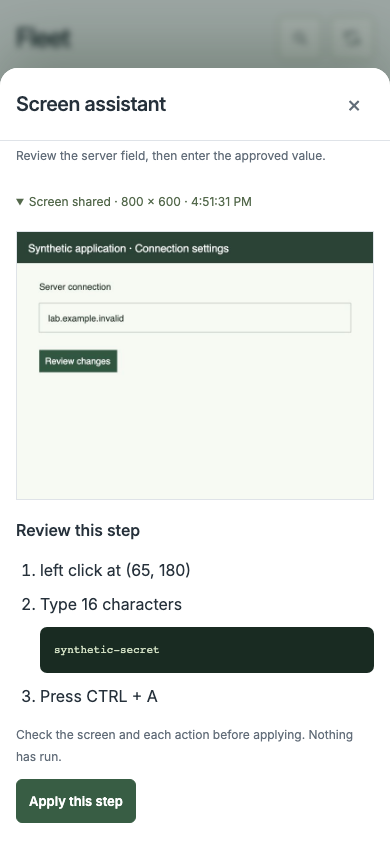](screen-step-review-390.png) |
| [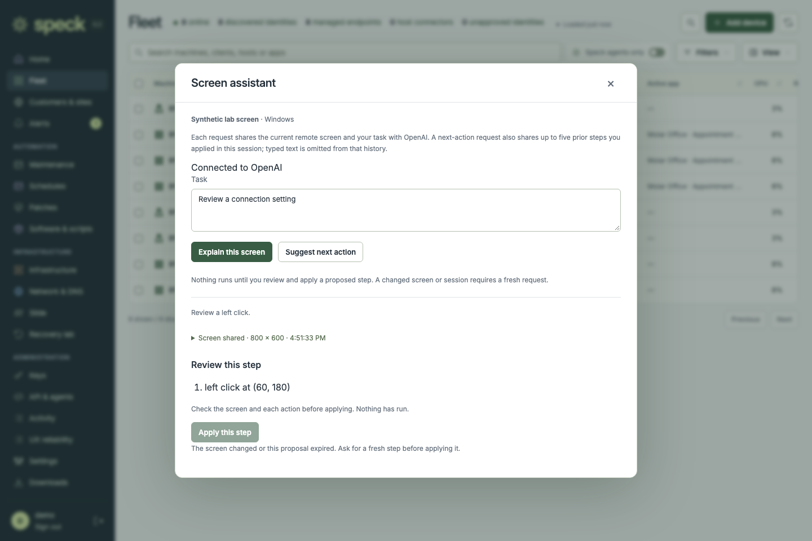](screen-changed-desktop.png) | [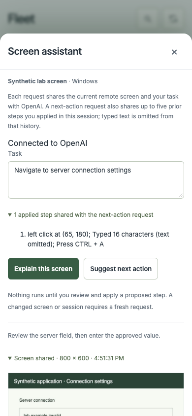](screen-history-390.png) |
| [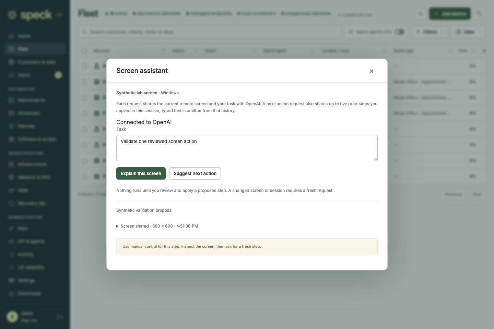](screen-manual-observation-desktop.png) | [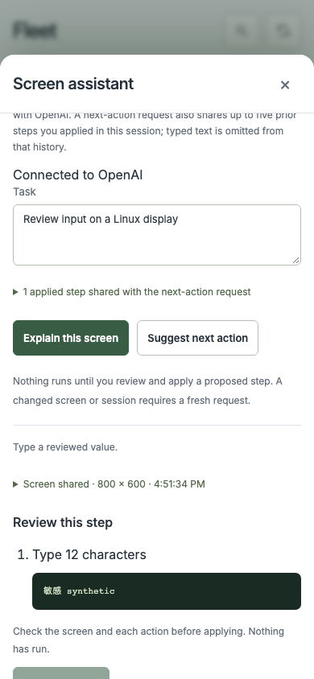](screen-receipt-error-phone.png) |

The [320 px review](screen-step-review-320.png) keeps the title and Close control
visible while reading the proposal. [Settings failure](screen-settings-error-phone.png)
remains retryable; [screen explanation](screen-explanation-phone.png) shares the
capture without offering input.

See [the release record](../../operations/ai-workflow-polish-2026-10-11.md) for
real-provider validation and platform limits.
